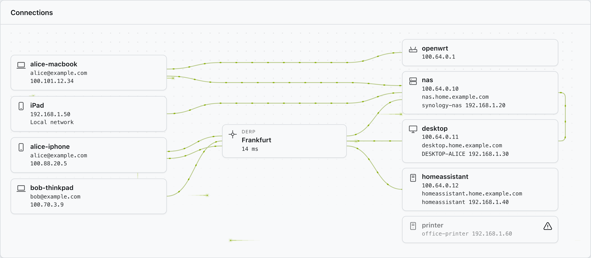
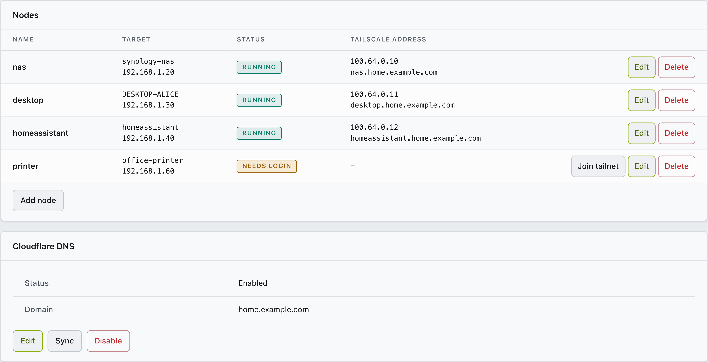
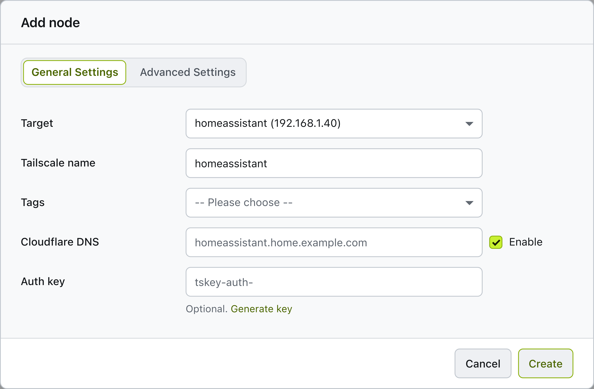

# tailscale-vnode

OpenWrt packages that give LAN hosts their own Tailscale node without
installing Tailscale on them.

For every configured host the router runs a separate `tailscaled` in its own
network namespace. Everything sent to that node's Tailscale address, on any
port or protocol, is forwarded to the host. Each host shows up in the tailnet
as a node of its own, with its own name and address and separate tags and
ACLs, and the clients need no subnet routes.

<picture>
  <source media="(prefers-color-scheme: dark)" srcset="docs/images/connections-en-dark.png">
  
</picture>

[中文说明](README.zh-CN.md)

## Features

- **One Tailscale node per LAN host.** Each node lives in its own network
  namespace with its own `tailscaled` and identity.
- **Target by IPv4 or MAC address.** A MAC target follows the host's DHCP
  lease, so the node keeps working when the host's address changes.
- **LuCI page** (`luci-app-tailscale-vnode`): add, edit, join and delete nodes.
  A live view shows who is connected to which node, directly or through which
  DERP relay.
- **Cloudflare DNS** (optional): an `A` record per node pointing at its
  Tailscale address, kept up to date. Only records the package created are
  ever changed.
- **Inbound connections** (optional): forwards each node's UDP port on the
  router, so that devices on the upstream network connect directly instead of
  through a relay.

## Requirements

- OpenWrt or ImmortalWrt 25.12 (apk)
- `tailscale`, `ip-full`, `kmod-veth`, `kmod-nft-nat`, `kmod-nft-fib`,
  `jsonfilter` and `curl` (pulled in as dependencies)

## Installation

Build the packages with the OpenWrt SDK or buildroot, using this repository
as a feed (the LuCI package also needs the `luci` feed):

```sh
echo 'src-git tailscale_vnode https://github.com/Mas0nShi/tailscale-vnode.git' >> feeds.conf
./scripts/feeds update tailscale_vnode
./scripts/feeds install -a -p tailscale_vnode
make package/tailscale-vnode/compile package/luci-app-tailscale-vnode/compile
```

Then install both `.apk` files on the router:

```sh
apk add --allow-untrusted tailscale-vnode-*.apk luci-app-tailscale-vnode-*.apk
```

## Usage

### LuCI

Open **Services → Tailscale Virtual Nodes**, choose **Add node**, pick a LAN
host and give the node a Tailscale name. With an auth key the node joins the
tailnet right away; without one, join it later from the node list.

<picture>
  <source media="(prefers-color-scheme: dark)" srcset="docs/images/nodes-en-dark.png">
  
</picture>

<p align="center">
  <picture>
    <source media="(prefers-color-scheme: dark)" srcset="docs/images/add-node-en-dark.png">
    
  </picture>
</p>

Tagged auth keys need a `tagOwners` entry for the tag in the tailnet policy.

### Command line

```sh
uci set tailscale-vnode.desktop=node
uci set tailscale-vnode.desktop.target=192.168.1.100   # or a MAC address
uci add_list tailscale-vnode.desktop.tag=tag:vnode
uci commit tailscale-vnode
/etc/init.d/tailscale-vnode reload

tailscale-vnode login desktop          # prompts for an auth key
tailscale-vnode status
tailscale-vnode connections desktop    # who is connected, by Tailscale device
tailscale-vnode restart desktop        # restart one node's tailscaled
tailscale-vnode ts desktop ping peer   # any tailscale command, for one node
```

`tailscale-vnode` without arguments lists every command. All settings are
documented in `/etc/config/tailscale-vnode`.

## How a node works


The node's namespace forwards everything sent to its Tailscale address to
the target, and rewrites the source to its own veth address so that replies
come back into the namespace instead of the router's own `tailscaled`. The
router then sends it on to the LAN as itself, so the target replies to its
gateway. The target therefore sees the router as the source of every
connection; `tailscale-vnode connections <node>` shows who is really
connected.

## What the package touches

Only its own objects, all prefixed `tsv` / `tailscale_vnode`:

| Object | Lifetime |
| --- | --- |
| `/etc/config/tailscale-vnode` | package conffile |
| `/etc/tailscale-vnode/<node>/` | node identity; kept across sysupgrade and uninstall |
| `/etc/tailscale-vnode/cloudflare.token` | Cloudflare API token, mode 600, only if set |
| netns `tsv-<node>`, veth `tsvh<i>`/`tsvn<i>`, nft table `inet tailscale_vnode`, `/etc/netns/tsv-<node>/` | created on start, removed on stop |
| `/usr/share/nftables.d/chain-pre/{forward,input}/30-tailscale-vnode.nft` | package files; fw4 includes them, `/etc/config/firewall` is untouched |
| `tailscale-vnode.conf` in dnsmasq's runtime conf-dir | DNS rebind exceptions for the Cloudflare domains, only while DNS is enabled |

The link network (`globals.subnet`, default `198.51.100.0/24`, TEST-NET-2) is
split into one /30 per node and never leaves the router. It must not be
link-local: `tailscaled` treats an interface with only a `169.254.0.0/16`
address as offline and never contacts the control server.

## Cloudflare DNS

Set it up in LuCI with an account API token that has *Zone · DNS · Edit* and
*Zone · Zone · Read*, and a domain in one of its zones. Each node then gets
`<tailscale name>.<domain>` (or a name of its own), DNS only, pointing at its
Tailscale IPv4 address. Records are tagged with the comment
`managed by tailscale-vnode: <node>`; a name that already has other records
is reported as a conflict and left alone.

The router's DNS rebind protection would drop these `100.64.0.0/10` answers,
so while DNS is enabled the package allows the configured domains in a
runtime dnsmasq snippet (`globals.dns_rebind`, on by default).

## Inbound connections

Off by default, as it opens UDP ports on the WAN side. When on, each node's
UDP port (`base_port` + index, or its own `port`) is forwarded to it and the
node advertises the router's upstream address as an endpoint. The advertised
address is read when a node starts; restart the service if the WAN address
changes.

## Limitations

- IPv4 only: targets are IPv4 hosts and records are `A` records.
- Hosts see the router, not the tailnet peer, as the source address.
- Nodes are reached through the router; a host does not get its own WireGuard
  endpoint.

## Development

Run from a checkout, against a router you can reach over SSH:

```sh
tools/deploy.sh root@router           # copy the files over, without packaging
node tools/update-po.js [new.json]    # refresh the translation template and po files
LUCI_URL=https://router LUCI_PASSWORD=... node tools/screenshot.js out/
```

`deploy.sh` only writes files and never changes the owner or mode of existing
directories. `screenshot.js` needs `playwright-core` and Google Chrome (set
`CHROME` to its executable outside macOS).

## License

GPL-2.0-only. See [LICENSE](LICENSE).
