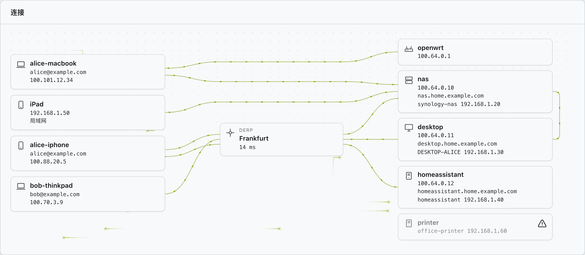
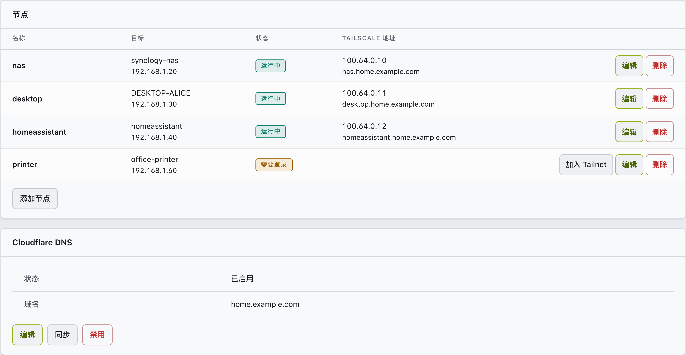
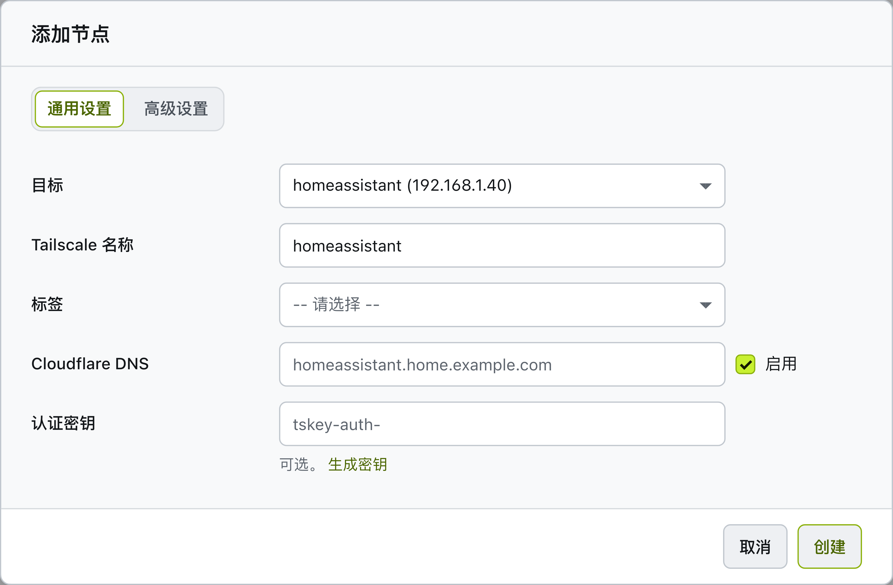

# tailscale-vnode

让局域网主机无需安装 Tailscale，也能拥有自己的 Tailscale 节点的 OpenWrt 软件包。

路由器为每台配置的主机在独立的网络命名空间里运行一个 `tailscaled`。发往该节点
Tailscale 地址的所有流量（任意端口和协议）都会转发给这台主机。每台主机在 tailnet
里都是一个独立的节点，有自己的名称和地址，可以单独设标签和 ACL，客户端也不需要子网路由。

<picture>
  <source media="(prefers-color-scheme: dark)" srcset="docs/images/connections-zh-dark.png">
  
</picture>

[English](README.md)

## 功能

- **每台局域网主机一个 Tailscale 节点**：每个节点有独立的网络命名空间、`tailscaled`
  和身份。
- **按 IPv4 或 MAC 地址指定目标**：MAC 目标会跟随主机的 DHCP 租约，主机地址变了
  节点照常工作。
- **LuCI 页面**（`luci-app-tailscale-vnode`）：添加、编辑、加入和删除节点。实时显示
  谁连着哪个节点，是直连还是经哪个 DERP 中继。
- **Cloudflare DNS**（可选）：为每个节点维护一条指向其 Tailscale 地址的 `A` 记录。
  只会修改本软件包创建的记录。
- **入站直连**（可选）：在路由器上转发每个节点的 UDP 端口，让上游网络里的设备直接
  连到节点，不经过中继。

## 环境要求

- OpenWrt 或 ImmortalWrt 25.12（apk）
- `tailscale`、`ip-full`、`kmod-veth`、`kmod-nft-nat`、`kmod-nft-fib`、`jsonfilter`、
  `curl`（作为依赖自动安装）

## 安装

用 OpenWrt SDK 或 buildroot 编译，把本仓库添加为 feed（LuCI 包还需要 `luci` feed）：

```sh
echo 'src-git tailscale_vnode https://github.com/Mas0nShi/tailscale-vnode.git' >> feeds.conf
./scripts/feeds update tailscale_vnode
./scripts/feeds install -a -p tailscale_vnode
make package/tailscale-vnode/compile package/luci-app-tailscale-vnode/compile
```

然后在路由器上安装两个 `.apk`：

```sh
apk add --allow-untrusted tailscale-vnode-*.apk luci-app-tailscale-vnode-*.apk
```

## 使用

### LuCI

打开 **服务 → Tailscale 虚拟节点**，点 **添加节点**，选择局域网主机并填写 Tailscale
名称。填了认证密钥的话节点会立即加入 tailnet。没填可以稍后在节点列表里加入。

<picture>
  <source media="(prefers-color-scheme: dark)" srcset="docs/images/nodes-zh-dark.png">
  
</picture>

<p align="center">
  <picture>
    <source media="(prefers-color-scheme: dark)" srcset="docs/images/add-node-zh-dark.png">
    
  </picture>
</p>

带标签的认证密钥需要在 tailnet 策略里为该标签配置 `tagOwners`。

### 命令行

```sh
uci set tailscale-vnode.desktop=node
uci set tailscale-vnode.desktop.target=192.168.1.100   # 或 MAC 地址
uci add_list tailscale-vnode.desktop.tag=tag:vnode
uci commit tailscale-vnode
/etc/init.d/tailscale-vnode reload

tailscale-vnode login desktop          # 提示输入认证密钥
tailscale-vnode status
tailscale-vnode connections desktop    # 当前连接，以及各自来自哪台 Tailscale 设备
tailscale-vnode restart desktop        # 只重启这个节点的 tailscaled
tailscale-vnode ts desktop ping peer   # 对单个节点执行任意 tailscale 命令
```

不带参数运行 `tailscale-vnode` 会列出所有命令。所有配置项的说明见
`/etc/config/tailscale-vnode`。

## 工作原理


节点的命名空间把发往它 Tailscale 地址的流量转发给目标主机，并把来源改成自己的 veth 地址，这样回包会回到这个命名空间，而不是路由器自己的 `tailscaled`。路由器再以自己的身份把流量发到局域网，目标主机照常回复给网关。所以目标主机看到的连接来源都是路由器，用 `tailscale-vnode connections <节点>` 可以查看实际是谁连进来的。

## 更多说明

占用的系统对象和 Cloudflare DNS、入站直连的细节，以及已知限制，见 [README.md](README.md) 对应章节。

## 许可证

GPL-2.0-only，见 [LICENSE](LICENSE)。
